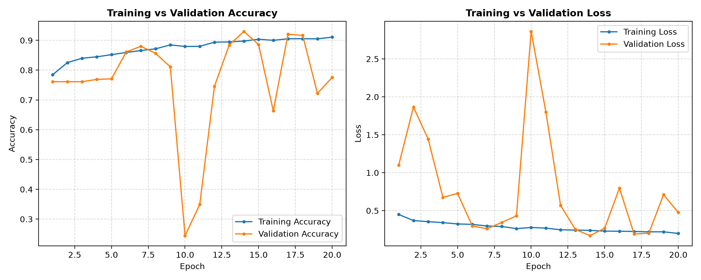
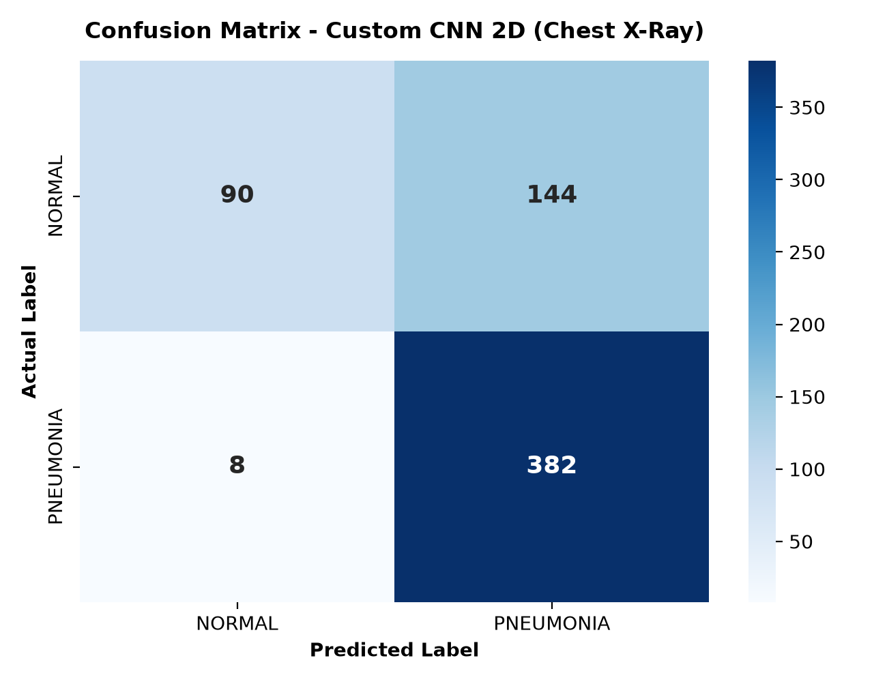

# Chest X-Ray Pneumonia Classification (Custom CNN 2D)

Implementasi klasifikasi citra medis **Chest X-Ray (NORMAL vs. PNEUMONIA)** menggunakan arsitektur **Convolutional Neural Network (CNN) 2D** yang dirancang *from scratch* dengan TensorFlow/Keras dan struktur kode modular.

* **Nama:** Muhammad Fachriditya
* **NIM:** 434241081
* **Mata Kuliah:** Pembelajaran Mesin / Deep Learning

---

## 1. Deskripsi Dataset

Proyek ini menggunakan dataset publik [Chest X-Ray Images (Pneumonia)](https://www.kaggle.com/datasets/paultimothymooney/chest-xray-pneumonia) dari Kaggle dengan rincian distribusi data sebagai berikut:

| Subset Data | NORMAL (Kelas 0) | PNEUMONIA (Kelas 1) | Total Citra | Keterangan |
| :--- | :---: | :---: | :---: | :--- |
| **Training (80%)** | ~1.073 | ~3.100 | **4.173** | Digunakan untuk pembaruan bobot model |
| **Validation (20%)** | ~268 | ~775 | **1.043** | Diambil dari split `train/` untuk memantau *overfitting* |
| **Testing (Unseen)** | 234 | 390 | **624** | Evaluasi akhir performa generalisasi model |

> **Penanganan Class Imbalance:** Karena jumlah citra `PNEUMONIA` hampir 3x lebih banyak dibanding `NORMAL`, pipeline secara otomatis menerapkan *class weighting* (`{0: 1.9448, 1: 0.673}`) selama proses *training*.

---

## 2. Struktur Direktori Proyek

```text
chest-xray-cnn-classifier/
├── assets/                          # Output model & grafik visualisasi evaluasi
│   ├── cnn_pneumonia_model.keras
│   ├── training_history.png
│   └── confusion_matrix_cnn.png
├── data/
│   └── raw/
│       └── chest_xray/              # Direktori dataset Kaggle (diabaikan oleh Git)
│           ├── train/
│           └── test/
├── src/
│   ├── __init__.py
│   ├── preprocessing.py             # Image loading, resizing, 80/20 split, class weights, prefetch
│   ├── model.py                     # Definisi arsitektur Custom CNN 2D (from scratch)
│   ├── train.py                     # Kompilasi model, Callbacks, dan eksekusi training
│   └── evaluate.py                  # Evaluasi Test Set, Classification Report, & plotting grafik
├── .gitignore
├── main.py                          # Orkestrator utama pipeline
├── README.md
└── requirements.txt
```

---

## 3. Arsitektur Model (`Custom_ChestXRay_CNN`)

Model dirancang dari nol (*from scratch*) dengan total **127.425 parameter** (`126.977` *trainable* dan `448` *non-trainable*):

1. **Input & Preprocessing Layer:**
   * Input citra RGB beresolusi `150 × 150 × 3`
   * *On-the-fly Data Augmentation*: `RandomFlip('horizontal')` & `RandomRotation(0.1)`
   * Normalisasi piksel dengan `Rescaling(1./255)`
2. **Feature Extraction (3 Convolutional Blocks):**
   * **Block 1:** `Conv2D(32, 3×3, padding='same')` $\rightarrow$ `LeakyReLU(0.1)` $\rightarrow$ `BatchNormalization` $\rightarrow$ `MaxPooling2D(2×2)` $\rightarrow$ `SpatialDropout2D(0.2)`
   * **Block 2:** `Conv2D(64, 3×3, padding='same')` $\rightarrow$ `LeakyReLU(0.1)` $\rightarrow$ `BatchNormalization` $\rightarrow$ `MaxPooling2D(2×2)` $\rightarrow$ `SpatialDropout2D(0.2)`
   * **Block 3:** `Conv2D(128, 3×3, padding='same')` $\rightarrow$ `LeakyReLU(0.1)` $\rightarrow$ `BatchNormalization` $\rightarrow$ `MaxPooling2D(2×2)` $\rightarrow$ `SpatialDropout2D(0.2)`
3. **Classification Head:**
   * `GlobalAveragePooling2D()` (mereduksi dimensi spasial tanpa lonjakan parameter)
   * `Dense(256)` $\rightarrow$ `LeakyReLU(0.1)` $\rightarrow$ `Dropout(0.4)`
   * Output: `Dense(1, activation='sigmoid')` untuk klasifikasi biner
4. **Konfigurasi Training:**
   * **Optimizer:** `Adam(learning_rate=0.0005)`
   * **Loss Function:** `binary_crossentropy`
   * **Callbacks:** `EarlyStopping(monitor='val_loss', patience=6, restore_best_weights=True)` dan `ReduceLROnPlateau(factor=0.5, patience=3)`

---

## 4. Cara Instalasi & Menjalankan Program

### Prasyarat
* Python 3.10 – 3.12
* Dataset Kaggle telah diekstrak ke dalam folder `data/raw/chest_xray/`

### Langkah Eksekusi (Linux / macOS)

1. **Clone repository dan masuk ke direktori proyek:**
   ```bash
   git clone <url-repository-anda>
   cd chest-xray-cnn-classifier
   ```

2. **Buat dan aktifkan Virtual Environment:**
   ```bash
   python3 -m venv venv
   source venv/bin/activate
   ```

3. **Install seluruh dependencies:**
   ```bash
   pip install --upgrade pip
   pip install -r requirements.txt
   ```

4. **Jalankan seluruh pipeline (Preprocessing $\rightarrow$ Training $\rightarrow$ Evaluation):**
   ```bash
   python main.py
   ```

---

## 5. Hasil Evaluasi & Visualisasi

Setelah eksekusi `main.py` selesai, seluruh artefak hasil evaluasi tersimpan otomatis di dalam folder `assets/`:

### Kurva Training & Validation (Accuracy & Loss)


### Confusion Matrix (Testing Dataset)
